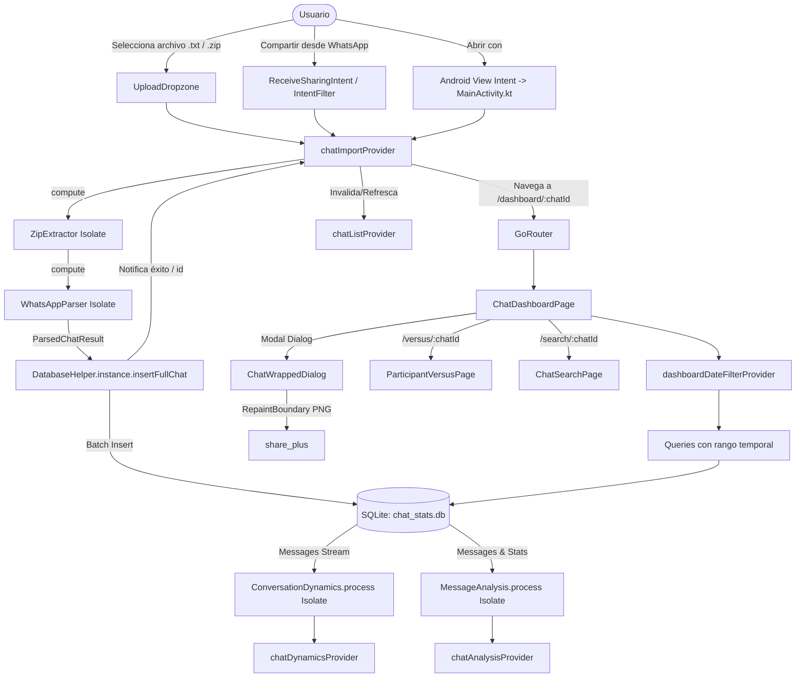

# AI Agent Context & Architecture Guide: Chats Stats

> **Propósito de este documento:** Este archivo contiene el contexto técnico exhaustivo, arquitectura, modelo de datos, flujo de comunicación entre features y reglas del proyecto **Chats Stats**. Está diseñado para que cualquier **agente de IA** pueda comprender el proyecto inmediatamente y comenzar a trabajar, refactorizar o añadir features sin necesidad de explorar todo el código fuente.

---

## 1. Visión General del Producto

- **Nombre de la App:** Chats Stats (`dev.codedd.chat_stats`)
- **Versión:** `2.4.0+9` (definida en [pubspec.yaml](file:///d:/FlutterProjects/chat_stats/pubspec.yaml))
- **Objetivo:** Importar chats exportados de WhatsApp (`.txt` o `.zip`), procesarlos y generar dashboards visuales, métricas avanzadas, roles sociales, comparativas cara a cara y un "Chat Wrapped" interactivo con historias compartibles.
- **Principio Fundamental (100% Offline / Local-First):**
  - **No existe backend ni servidores propios.**
  - Ningún mensaje ni metadato sale del dispositivo móvil.
  - Base de datos local SQLite (`chat_stats.db`) con transacciones por lotes e índices de alto rendimiento.
  - Todo el procesamiento pesado (descompresión, parsing regex de WhatsApp, análisis de palabras/emojis, dinámicas conversacionales) se ejecuta en **Isolates de Dart en segundo plano** mediante `compute()` para garantizar 60/120 FPS sin bloqueos de UI (cero ANRs).

---

## 2. Stack Tecnológico & Dependencias Clave

| Dependencia | Versión | Uso Principal |
|---|---|---|
| **Flutter SDK** | `^3.12.2` | Framework UI multiplataforma (foco Android/iOS, soporte desktop FFI) |
| **flutter_riverpod** | `^3.4.2` | Gestión de estado reactivo moderno (`Notifier`, `AsyncNotifier`, `FutureProvider.family`) |
| **go_router** | `^18.0.1` | Enrutamiento declarativo con parámetros de ruta y transiciones personalizadas |
| **sqflite** / **sqflite_common_ffi** | `^2.4.3` / `^2.4.2` | Base de datos SQLite local (FFI para desktop/tests) |
| **fl_chart** | `^1.2.0` | Gráficos vectoriales de barras, líneas y heatmap de actividad horaria |
| **archive** | `^4.0.9` | Descompresión en streaming de archivos `.zip` de WhatsApp |
| **receive_sharing_intent** | `^1.9.0` | Recepción de archivos compartidos directamente desde WhatsApp al menú "Compartir" |
| **file_picker** | `^12.0.0-beta.7` | Selector de archivos `.txt` y `.zip` desde el almacenamiento del usuario |
| **local_auth** | `^3.0.2` | Bloqueo de seguridad con biometría (huella, Face ID, PIN del dispositivo) |
| **share_plus** | `^13.3.1` | Compartir imágenes PNG generadas del "Chat Wrapped" en redes sociales |
| **google_mobile_ads** | `^9.1.0` | Monetización con AdMob (Banner e Intersticiales precargados con timeout) |
| **google_fonts** | `^8.2.1` | Tipografías Inter y Space Grotesk |
| **shared_preferences** | `^2.5.5` | Almacenamiento clave-valor para flags de privacidad/bloqueo |

---

## 3. Estructura de Directorios

```text
lib/
├── app.dart                                # Configuración de MaterialApp.router, temas, scale factors
├── main.dart                               # Inicialización de Flutter, Intl, runApp y AdService asíncrono
├── core/
│   ├── constants/
│   │   └── ad_constants.dart               # IDs de prueba y producción de AdMob
│   ├── local/
│   │   └── database_helper.dart            # Singleton SQLite: DDL, migraciones, índices y queries analíticas
│   ├── router/
│   │   └── app_router.dart                 # Configuración de rutas GoRouter ('/', '/dashboard/:chatId', etc.)
│   ├── services/
│   │   ├── ad_service.dart                 # Manejo no bloqueante de anuncios (precarga e intersticial con timeout)
│   │   └── privacy_service.dart            # Autenticación biométrica con local_auth
│   ├── theme/
│   │   ├── app_colors.dart                 # Paleta dark mode (Background #0B141B, Primary WhatsApp #25D366)
│   │   └── app_theme.dart                  # ThemeData Material 3 dark con GoogleFonts.inter y spaceGrotesk
│   └── widgets/
│       ├── ad_banner_widget.dart           # Widget reutilizable para banner AdMob
│       └── app_snackbar.dart               # Helpers para mostrar SnackBar en contexto global
└── features/
    ├── chat_import/
    │   ├── domain/models/
    │   │   ├── chat_model.dart             # Modelo de cabecera de chat (id, name, totalMessages, span, etc.)
    │   │   ├── chat_message_model.dart     # Modelo de mensaje individual (timestamp, sender, content, flags)
    │   │   └── participant_model.dart      # Resumen por participante (mensajes, palabras, multimedia)
    │   ├── presentation/
    │   │   ├── pages/chat_history_page.dart # Pantalla principal: dropzone de subida, lista de chats guardados
    │   │   ├── providers/chat_import_provider.dart # Providers: chatImportProvider y chatListProvider
    │   │   └── widgets/
    │   │       ├── chat_card.dart          # Tarjeta de chat guardado con swipe para eliminar y acceso rápido
    │   │       └── upload_dropzone.dart    # Zona interactiva para importar chats
    │   └── utils/
    │       ├── whatsapp_parser.dart        # Parser regex (Android/iOS, bidi sanitize, multilínea, compute)
    │       └── zip_extractor.dart          # Extracción segura de .txt desde .zip en isolate
    └── chat_dashboard/
        ├── domain/models/
        │   ├── conversation_dynamics.dart  # Métricas: rachas, iniciadores, hilos, silencios, tiempos de respuesta
        │   └── message_analysis.dart       # Métricas: top palabras, emojis generales y por usuario, nocturnos, etc.
        ├── presentation/
        │   ├── pages/
        │   │   ├── chat_dashboard_page.dart # Dashboard principal con todos los KPIs, gráficos y filtros
        │   │   ├── chat_search_page.dart    # Búsqueda en mensajes con debounce de 300ms
        │   │   └── participant_versus_page.dart # Duelo Cara a Cara ⚔️ entre 2 participantes
        │   ├── providers/
        │   │   └── chat_dashboard_provider.dart # Providers reactivos para filtros, análisis y consultas SQLite
        │   └── widgets/
        │       ├── activity_chart.dart      # Gráfico de barras de mensajes por día (fl_chart)
        │       ├── activity_heatmap.dart    # Heatmap 7x24 de días de la semana vs horas
        │       ├── hourly_chart.dart        # Distribución de mensajes por hora del día
        │       ├── kpi_card.dart            # Tarjetas de indicadores clave (mensajes, multimedia, palabras)
        │       ├── participants_chart.dart  # Ranking de participantes y porcentaje de participación
        │       ├── records_card.dart        # Tarjeta del día récord de mensajes
        │       ├── conversation_dynamics.dart # Visualización de iniciadores, respuestas y silencios
        │       ├── social_roles_section.dart # Roles sociales (Escritor, Preguntón, Noctámbulo, etc.)
        │       ├── message_analysis_section.dart # Top emojis, palabras frecuentes, mensajes editados/borrados
        │       └── chat_wrapped_dialog.dart # Historias animadas estilo Spotify/Instagram Wrapped + compartir PNG
```

---

## 4. Desglose de Features y Funcionamiento Técnico

### 4.1. Feature: `chat_import` (Importación y Parsing)

1. **Vías de entrada de datos:**
   - **Selector manual:** [upload_dropzone.dart](file:///d:/FlutterProjects/chat_stats/lib/features/chat_import/presentation/widgets/upload_dropzone.dart) -> `pickAndImportChatFile()` con `file_picker` (extensiones `.txt` y `.zip`).
   - **Compartir desde WhatsApp (Share Intent):** [chat_history_page.dart](file:///d:/FlutterProjects/chat_stats/lib/features/chat_import/presentation/pages/chat_history_page.dart) escucha `ReceiveSharingIntent.instance.getMediaStream()` y `getInitialMedia()`.
   - **Abrir con (View Intent de Android):** `MethodChannel('dev.codedd.chat_stats/app_intent')` gestiona `onViewFile` y `getInitialFile` procesados en [MainActivity.kt](file:///d:/FlutterProjects/chat_stats/android/app/src/main/kotlin/dev/codedd/chat_stats/MainActivity.kt). Copia el stream a un archivo en caché para sortear restricciones de `content://` URI de Android.

2. **Procesamiento en Isolates (`compute`):**
   - **[ZipExtractor](file:///d:/FlutterProjects/chat_stats/lib/features/chat_import/utils/zip_extractor.dart):**
     - Si es `.zip`, busca `_chat.txt` o archivos que comiencen con `Chat de WhatsApp`.
     - Si es `.txt`, decodifica UTF-8 con fallback a Latin1 en caso de error de codificación.
   - **[WhatsAppParser](file:///d:/FlutterProjects/chat_stats/lib/features/chat_import/utils/whatsapp_parser.dart):**
     - **Sanitización de caracteres bidi invisibles:** Remueve caracteres de control Unicode `\u200e`, `\u200f`, `\u2066-\u2069` que WhatsApp inserta alrededor de nombres y menciones.
     - **Formatos soportados:** Formato Android (`3/7/24, 14:31 - Mensaje`) y formato iOS (`[03/07/2024, 14:31:00] Mensaje`).
     - **Detección inteligente de fechas:** Analiza una muestra de 100 mensajes para determinar si el formato es `DD/MM/YYYY` o `MM/DD/YYYY`.
     - **Mensajes multilínea:** Se concatenan al mensaje anterior hasta encontrar un encabezado de fecha válido.
     - **Detección de estados:** Mensajes del sistema (`is_system`), multimedia omitida (`is_media`), mensajes editados (`is_edited`) y eliminados (`is_deleted`).
     - **Conteo de palabras y caracteres:** Calculado en isolate durante el parsing inicial.

3. **Inserción en Base de Datos:**
   - Realizada mediante transacción atómica [DatabaseHelper.instance.insertFullChat](file:///d:/FlutterProjects/chat_stats/lib/core/local/database_helper.dart#L139-L165):
     - Inserta cabecera en `chats`.
     - Inserta mensajes por lotes con `batch.insert('messages', ...)` (usando `chat_id` generado).
     - Inserta participantes con `batch.insert('participants', ...)`.
     - Devuelve el `chatId` y actualiza el estado a `ImportStatus.success`.

4. **Providers involucrados:**
   - `chatImportProvider` (`ChatImportNotifier`): Controla el estado del proceso de importación (`idle`, `loading`, `success`, `error`).
   - `chatListProvider` (`ChatListNotifier`): `AsyncNotifierProvider.autoDispose` que lista todos los chats guardados y maneja la eliminación con borrado en cascada.

---

### 4.2. Feature: `chat_dashboard` (Analítica, KPIs y Gráficos)

1. **Ruta y Navegación:** `/dashboard/:chatId` (definida en [app_router.dart](file:///d:/FlutterProjects/chat_stats/lib/core/router/app_router.dart#L37-L50)).

2. **Filtro de Fechas Reactivo:**
   - Controlado por `dashboardDateFilterProvider` (`DashboardDateFilterNotifier`).
   - Modos: `all`, `last30Days`, `last90Days`, `thisYear`, `custom`.
   - Convierte el filtro a tupla de marcas de tiempo `({int? startTs, int? endTs})`.
   - **Reactividad:** Todos los providers analíticos (`chatFilteredSummaryProvider`, `chatParticipantsProvider`, `chatDailyActivityProvider`, `chatHourlyDistributionProvider`, `chatHeatmapProvider`, `chatDynamicsProvider`, `chatAnalysisProvider`, `chatRecordDayProvider`) consumen `dashboardDateFilterProvider`. Cambiar el filtro actualiza automáticamente toda la pantalla.

3. **Cálculo de Dinámicas de Conversación (`ConversationDynamics`):**
   - Ejecutado en isolate en segundo plano (`_processDynamicsInBackground`).
   - **Iniciadores:** Identifica quién inicia una conversación después de una pausa mayor a 6 horas.
   - **Tiempos de respuesta:** Calcula la mediana y promedio del tiempo que tarda cada participante en responder al mensaje de otro.
   - **Hilos más largos:** Conversaciones continuas con mayor intercambio de mensajes.
   - **Silencios:** Identifica el período de inactividad más largo entre dos mensajes consecutivos.
   - **Rachas de conversación:** Cuenta el número máximo y actual de días consecutivos con al menos un mensaje enviado.

4. **Análisis de Mensajes y Contenido (`MessageAnalysis`):**
   - Ejecutado en isolate en segundo plano (`_processAnalysisInBackground`).
   - **Top palabras:** Filtra stop words comunes en español e inglés, calcula frecuencias globales.
   - **Top emojis:** Mapea emojis generales del chat y desglose de emojis favoritos por participante.
   - **Estadísticas avanzadas:** Total de mensajes editados, mensajes eliminados, enlaces compartidos (`http/https`), preguntas formuladas (`?` o `¿`), mensajes enviados de noche/madrugada (00:00 a 06:00) y menciones (@usuario).

5. **Roles Sociales (`SocialRolesSection`):**
   - Deduce arquetipos sociales basados en los datos:
     - ✍️ *El Escritor:* Mayor promedio de palabras por mensaje.
     - ❓ *El Curioso / Preguntón:* Mayor cantidad de preguntas realizadas.
     - 🦉 *El Noctámbulo:* Mayor volumen de mensajes entre 00:00 y 06:00.
     - 🌟 *El Popular / Mencionado:* Más menciones recibidas en el chat.
     - 🎤 *El Monologuista:* Mayor racha de mensajes consecutivos sin que nadie más escriba.
     - ⚡ *El Rayo vs El Relajado:* Participante más rápido en responder vs más tardío.

---

### 4.3. Feature: `chat_wrapped` (Historias Animadas Compartibles)

1. **Ubicación:** [chat_wrapped_dialog.dart](file:///d:/FlutterProjects/chat_stats/lib/features/chat_dashboard/presentation/widgets/chat_wrapped_dialog.dart).
2. **Estructura de las Historias:**
   - 5 diapositivas estilo Instagram / Spotify Wrapped con gradientes y animaciones:
     - **Story 1: Resumen General:** Total mensajes, palabras, multimedia y duración del chat.
     - **Story 2: Récords y Dinámicas:** El día más activo de la historia y quién suele revivir el chat.
     - **Story 3: Emojis y Palabras:** Palabras icónicas del grupo y emojis más repetidos.
     - **Story 4: Personalidades del Grupo:** Premios y roles asignados a los participantes.
     - **Story 5: Resumen Final:** Tarjeta insignia de resumen con marca del chat.
3. **Mecánica de Interacción:**
   - Barras de progreso automáticas superiores (6 segundos por historia).
   - Taps a la izquierda para retroceder, a la derecha para avanzar.
   - Pulsación prolongada (Long Press) para pausar la animación.
4. **Exportación y Compartir:**
   - Envuelve el slide actual en un `RepaintBoundary` con `GlobalKey`.
   - Renderiza la vista a mapa de bits con resolución nítida (`boundary.toImage(pixelRatio: 2.5)`).
   - Guarda como PNG temporal en `getTemporaryDirectory()` y lanza el selector nativo del sistema vía `SharePlus.instance.share()`.

---

### 4.4. Feature: `participant_versus` (Duelo Cara a Cara ⚔️)

1. **Ruta y Navegación:** `/versus/:chatId` (definida en [app_router.dart](file:///d:/FlutterProjects/chat_stats/lib/core/router/app_router.dart#L68-L81)).
2. **Página:** [participant_versus_page.dart](file:///d:/FlutterProjects/chat_stats/lib/features/chat_dashboard/presentation/pages/participant_versus_page.dart).
3. **Funcionamiento:**
   - Permite seleccionar 2 participantes del chat mediante selectores desplegables.
   - Compara cara a cara métricas clave:
     - Mensajes totales y porcentaje.
     - Palabras totales y promedio de caracteres por mensaje.
     - Archivos multimedia compartidos.
     - Emojis favoritos de cada uno.
     - Velocidad promedio de respuesta.
     - Mensajes nocturnos (madrugadas).
     - Preguntas formuladas y monólogos consecutivos.
   - Destaca visualmente con barras comparativas porcentuales y medallas al ganador de cada categoría.

---

### 4.5. Feature: `chat_search` (Búsqueda de Mensajes)

1. **Ruta y Navegación:** `/search/:chatId` con query param opcional `?query=...` (definida en [app_router.dart](file:///d:/FlutterProjects/chat_stats/lib/core/router/app_router.dart#L52-L66)).
2. **Página:** [chat_search_page.dart](file:///d:/FlutterProjects/chat_stats/lib/features/chat_dashboard/presentation/pages/chat_search_page.dart).
3. **Funcionamiento:**
   - Campo de búsqueda en tiempo real con debounce de 300 milisegundos (`Timer`).
   - Query en SQLite: `SELECT * FROM messages WHERE chat_id = ? AND content LIKE ? ORDER BY timestamp DESC LIMIT 100`.
   - Muestra fecha, hora, remitente, contenido del mensaje y badges si es multimedia o editado.

---

### 4.6. Servicios Transversales (`core/services`)

1. **[PrivacyService](file:///d:/FlutterProjects/chat_stats/lib/core/services/privacy_service.dart):**
   - Utiliza `local_auth` y `shared_preferences` (`app_privacy_lock_enabled`).
   - Si está activado, en cada apertura de [chat_history_page.dart](file:///d:/FlutterProjects/chat_stats/lib/features/chat_import/presentation/pages/chat_history_page.dart) solicita autenticación biométrica (o PIN/patrón del sistema) antes de mostrar los chats almacenados.
2. **[AdService](file:///d:/FlutterProjects/chat_stats/lib/core/services/ad_service.dart):**
   - Inicialización asíncrona no bloqueante en `main.dart` mediante `unawaited(AdService.instance.initialize())`.
   - Precarga intersticiales en segundo plano.
   - Al mostrar un intersticial (`showInterstitialAd({onAdDismissed})`), incluye un timeout de seguridad de 3 segundos para que, si el anuncio falla o tarda en cargar, la navegación del usuario **nunca** se congele.

---

## 5. Diagrama de Flujo y Comunicación entre Componentes



---

## 6. Esquema de Base de Datos SQLite (`chat_stats.db`)

Versión actual de la base de datos: `version: 2`.

```sql
-- 1. Tabla de Chats
CREATE TABLE chats (
  id INTEGER PRIMARY KEY AUTOINCREMENT,
  name TEXT NOT NULL,
  file_name TEXT NOT NULL,
  created_at INTEGER NOT NULL,
  total_messages INTEGER NOT NULL,
  total_media INTEGER NOT NULL,
  total_words INTEGER NOT NULL,
  participant_count INTEGER NOT NULL,
  first_message_time INTEGER,
  last_message_time INTEGER
);

-- 2. Tabla de Mensajes
CREATE TABLE messages (
  id INTEGER PRIMARY KEY AUTOINCREMENT,
  chat_id INTEGER NOT NULL,
  timestamp INTEGER NOT NULL,
  date_str TEXT NOT NULL,
  time_str TEXT NOT NULL,
  sender TEXT NOT NULL,
  content TEXT NOT NULL,
  is_system INTEGER NOT NULL DEFAULT 0,
  is_media INTEGER NOT NULL DEFAULT 0,
  is_edited INTEGER NOT NULL DEFAULT 0,
  is_deleted INTEGER NOT NULL DEFAULT 0,
  word_count INTEGER NOT NULL DEFAULT 0,
  char_count INTEGER NOT NULL DEFAULT 0,
  FOREIGN KEY (chat_id) REFERENCES chats (id) ON DELETE CASCADE
);

-- 3. Tabla de Participantes
CREATE TABLE participants (
  id INTEGER PRIMARY KEY AUTOINCREMENT,
  chat_id INTEGER NOT NULL,
  name TEXT NOT NULL,
  message_count INTEGER NOT NULL,
  media_count INTEGER NOT NULL,
  word_count INTEGER NOT NULL,
  FOREIGN KEY (chat_id) REFERENCES chats (id) ON DELETE CASCADE
);

-- Índices de Rendimiento Obligatorios
CREATE INDEX idx_messages_chat_id ON messages(chat_id);
CREATE INDEX idx_messages_timestamp ON messages(chat_id, timestamp);
CREATE INDEX idx_messages_sender ON messages(chat_id, sender);
CREATE INDEX idx_messages_system_media ON messages(chat_id, is_system, is_media);
CREATE INDEX idx_participants_chat ON participants(chat_id);
```

---

## 7. Reglas y Convenciones Críticas para Agentes IA

1. **Nunca ejecutar computación pesada en el hilo principal de Flutter:**
   - Si vas a procesar listas largas de mensajes, parsear strings, generar estadísticas o descomprimir archivos, **debes usar `compute(funcionTopLevelOMetodoEstatico, datos)`**.
2. **Preservar el principio 100% Offline / Privacidad:**
   - No instales ni utilices SDKs de telemetría remota, Firebase Analytics, Crashlytics o llamadas HTTP a APIs de terceros que envíen datos del chat. Los permisos de red en `AndroidManifest.xml` solo son para Google Fonts y anuncios AdMob.
3. **Gestión de Estado con Riverpod 3.0:**
   - Usa `Notifier` o `AsyncNotifier` para lógica de mutación de estado.
   - Usa `FutureProvider.family.autoDispose` para consultas asíncronas indexadas por `chatId`.
   - Reutiliza `ref.watch(dashboardDateFilterProvider)` dentro de cualquier nuevo provider analítico para que responda automáticamente al selector de fechas.
4. **Navegación con GoRouter:**
   - Todas las rutas están centralizadas en [lib/core/router/app_router.dart](file:///d:/FlutterProjects/chat_stats/lib/core/router/app_router.dart).
   - Siempre pasa el `chatId` como parámetro de ruta entero: `/dashboard/:chatId`, `/versus/:chatId`, `/search/:chatId`.
5. **Base de Datos SQLite:**
   - Siempre habilita `PRAGMA foreign_keys = ON` (ya implementado en `_onConfigure`).
   - Al agregar nuevas columnas, gestiona la migración incremental en `_onUpgrade` y actualiza la versión de la base de datos.
6. **Manejo de Anuncios:**
   - La llamada `AdService.instance.showInterstitialAd({onAdDismissed})` siempre debe invocar `onAdDismissed` independientemente de si el anuncio carga, falla o se cancela. Nunca bloquees una transición de pantalla esperando un anuncio.
7. **Diseño Visual:**
   - Mantén la estética del tema oscuro definida en [app_colors.dart](file:///d:/FlutterProjects/chat_stats/lib/core/theme/app_colors.dart) y [app_theme.dart](file:///d:/FlutterProjects/chat_stats/lib/core/theme/app_theme.dart). Usa los colores de superficie (`surfaceContainer`, `surfaceContainerHigh`) y el color de acento esmeralda de WhatsApp (`#25D366`).
